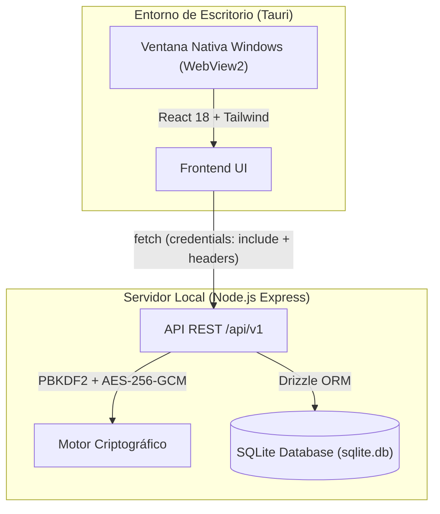

# 🔐 Gestor de Contraseñas (Zero-Knowledge Desktop & Web)

Un gestor de contraseñas multi-perfil moderno, seguro y de arquitectura **Zero-Knowledge**, diseñado para funcionar tanto como aplicación web como aplicación de escritorio nativa (.exe para Windows) gracias a **Tauri**.

---

## ✨ Características Principales

- **🛡️ Arquitectura Zero-Knowledge**: La clave maestra **nunca se almacena** en la base de datos ni se envía en texto plano persistente. Las llaves de cifrado se derivan al vuelo usando PBKDF2 (100,000 iteraciones) y los secretos se encriptan con **AES-256-GCM**.
- **👥 Multi-perfil estilo Netflix**: La app abre directamente en una pantalla de selección de usuarios. Permite alternar fácilmente entre perfiles en la misma computadora sin fricción.
- **🔢 PIN de Acceso Rápido (4 dígitos)**: Al iniciar sesión completa con la contraseña maestra, el sistema genera un PIN temporal (TTL de 15 minutos) almacenado en SQLite. Si sales al menú principal ("Salir al Main"), puedes volver a entrar introduciendo únicamente tu PIN de 4 dígitos mediante un teclado numérico táctil/visual.
- **⏱️ Temporizador de Sesión y Auto-Lock**: 
  - Monitorea la expiración de la sesión de 15 minutos en tiempo real.
  - En los **últimos 5 minutos**, despliega un banner de advertencia con cuenta regresiva.
  - En el **último minuto**, el banner cambia a alerta roja pulsante.
  - Al llegar a **00:00**, ejecuta un bloqueo seguro automático (`lock`) que destruye la cookie de acceso y redirige a la pantalla principal.
- **⚡ Generador Criptográfico**: Genera contraseñas aleatorias seguras (de 6 a 64 caracteres) directamente en el backend mediante `crypto.randomInt`.
- **🖥️ Modo Escritorio (.exe) y Web**: Ejecutable como aplicación de escritorio ultra-ligera (~10 MB) con Tauri o en navegador convencional con Vite.

---

## 🏗️ Arquitectura Técnica



### Stack de Tecnologías

- **Frontend**: React 18, TypeScript, Tailwind CSS, React Router v7, Vite.
- **Escritorio**: Tauri v2 (Rust shell nativo para Windows).
- **Backend**: Node.js, Express, TypeScript, better-sqlite3, Drizzle ORM, Zod, JsonWebToken, Bcrypt.

---

## 📋 Prerrequisitos

1. **Node.js**: Versión 18+ (recomendado v20 o v22).
2. **Para compilar en Escritorio (Tauri)**:
   - **Rust**: Instalado vía `rustup` (`cargo` y `rustc`).
   - **Microsoft C++ Build Tools**: Instalador de Visual Studio 2022 con el paquete *Desarrollo de escritorio con C++*.
   - **WebView2 Runtime**: Incluido por defecto en Windows 10/11.

---

## 🚀 Instalación y Puesta en Marcha

Clona el repositorio e instala las dependencias de los workspaces:

```bash
git clone <url-del-repositorio>
cd Gestor_Contra
npm install
```

### 1. Variables de Entorno

**Backend (`backend/.env`):**
```env
PORT=3000
NODE_ENV=development
DB_FILE_NAME=sqlite.db
JWT_SECRET=tu_secreto_super_seguro
JWT_EXPIRES_IN=15m
BCRYPT_SALT_ROUNDS=10
CLIENT_URL=
```

**Frontend (`frontend/.env`):**
```env
VITE_API_URL=http://localhost:3000/api/v1
```

---

## 💻 Comandos de Ejecución

El proyecto está configurado con npm workspaces en la raíz:

### 🌐 Modo Web (Navegador)

Abre dos terminales o corre concurrentemente:

```bash
# Terminal 1: Backend API (puerto 3000)
npm run dev:backend

# Terminal 2: Frontend Vite (puerto 5173)
npm run dev:frontend
```

Visita `http://localhost:5173` en tu navegador.

---

### 🖥️ Modo Escritorio (Desarrollo)

Para abrir la ventana nativa durante el desarrollo:

```bash
# Terminal 1: Iniciar backend
npm run dev:backend

# Terminal 2: Iniciar ventana Tauri
npm run dev:desktop
```

---

## 📦 Compilación a Instalador Autónomo (.exe)

Para compilar el instalador final listo para distribución (100% autónomo, empaqueta el backend y su base de datos sin requerir internet ni Node.js en la PC del usuario):

```bash
npm run build:desktop
```

El instalador ejecutable (`.exe`) se genera automáticamente en:
```text
frontend/src-tauri/target/release/bundle/nsis/Gestor de Contraseñas_1.0.0_x64-setup.exe
```
*Peso aproximado: **~22 MB**.* Al instalarlo y abrir la aplicación, el servidor local arranca en segundo plano de forma transparente y la base de datos se almacena de forma persistente y segura en `%APPDATA%\GestorContrasenas\sqlite.db`.*

---

## 🔒 Mecanismos de Seguridad Explicados

| Mecanismo | Implementación |
|---|---|
| **Derivación de Clave** | PBKDF2 con SHA-256, 100,000 iteraciones y salt único por usuario. |
| **Cifrado de Secretos** | AES-256-GCM con IV único de 16 bytes y AuthTag de 16 bytes por cada contraseña. |
| **Transporte de Clave** | Header seguro `X-Master-Password` en endpoints específicos de desencriptación. |
| **Protección contra CSRF** | Cookies HTTP-only con `SameSite: Lax` y validación de tokens JWT con caducidad estricta (15 min). |
| **Botón 'Salir al Main'** | Endpoint `/api/v1/users/lock` que revoca la cookie sin invalidar el PIN de sesión temporal en DB. |

---

## 📄 Licencia

Este proyecto es de uso personal y educativo. Libre para modificar y adaptar.
